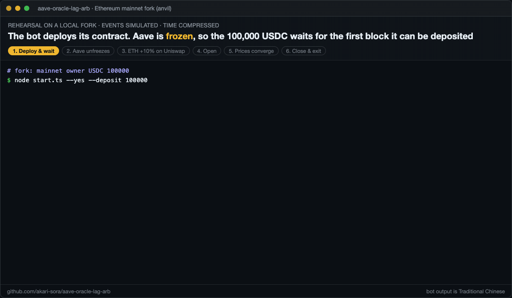
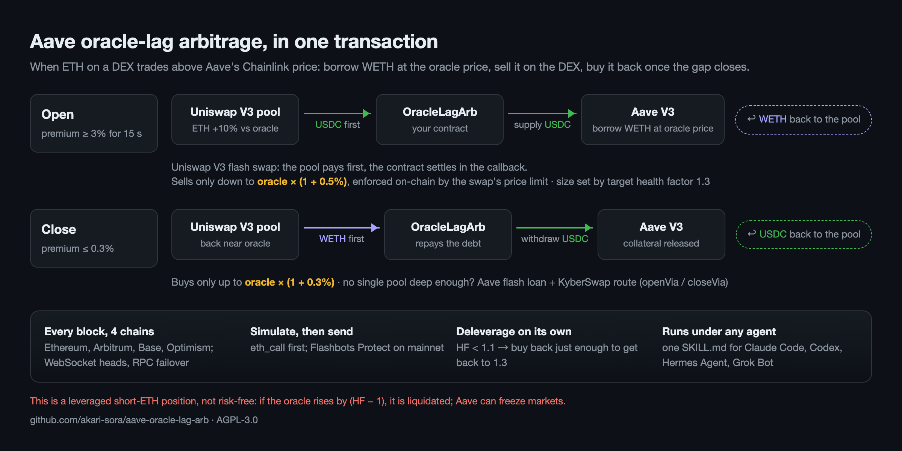

# aave-oracle-lag-arb

Uniswap의 ETH 가격이 Aave의 Chainlink 오라클 가격보다 크게 높을 때, Aave에서 오라클 가격으로 WETH를 대출받아 DEX에서 매도하고 가격 괴리가 해소되면 다시 매수하여 상환합니다.

[English](README.md) · [繁體中文](README.zh-TW.md) · [简体中文](README.zh-CN.md) · [日本語](README.ja.md) · 한국어

공식 저장소, 이슈 및 릴리스: https://gitlab.com/aa22396584/aave-oracle-lag-arb

## 주요 기능

- Solidity 컨트랙트 `OracleLagArb`는 "스테이블코인 예치 → 오라클 가격으로 WETH 대출 → Uniswap에서 매도 → 재예치" 과정을 단일 플래시 스왑 트랜잭션으로 압축하며, 최소 매도 가격을 온체인에서 오라클 가격과 대조해 검증합니다.
- TypeScript 봇이 매 블록마다 Ethereum, Arbitrum, Base, Optimism을 모니터링합니다. 프리미엄이 유지될 때만 포지션을 진입하고, 프리미엄이 사라지면 재매수하여 상환하며, 헬스 팩터가 하락하면 자동으로 디레버리징합니다.
- Linux 슈퍼바이저와 설정 스크립트가 헬스 체크 및 웹훅 알림과 함께 봇을 상시 운영합니다.
- 에이전트 스킬을 통해 Claude Code, Codex, Hermes Agent, Grok Bot 등의 에이전트가 봇을 대신 설치하고 모니터링할 수 있습니다.

**위험 고지: 이 전략은 무위험 차익거래가 아닌 레버리지 ETH 숏 포지션입니다. ETH 가격이 크게 상승하면 포지션이 청산됩니다. Aave는 언제든 마켓을 동결할 수 있습니다. 사용 전 반드시 [면책 조항](DISCLAIMER.ko.md)을 읽으시기 바랍니다.**



*현재 코드로 로컬 anvil Ethereum 메인넷 포크에서 진행한 예행연습: Aave 동결 해제 후 Uniswap의 ETH 가격이 오라클 대비 10% 높게 형성되자 봇이 포지션을 진입하고, 가격이 수렴하자 포지션을 종료하고 출금합니다(100,000 → 116,484 USDC). 시뮬레이션된 이벤트이며 시간은 압축되어 있습니다(실제 거래 아님).*

CLI 메시지는 기본적으로 번체 중국어로 출력되며 `BOT_LANG=en`으로 설정하면 영어로 전환됩니다. 코드 주석은 번체 중국어로 작성되어 있습니다.

## 배경

2026-10-29 Binance 핫월렛이 털리면서 Binance가 출금을 중단했습니다. 거래소 내부의 ETH가 빠져나오지 못하자, 한동안 Uniswap의 ETH 가격이 외부 시장보다 10%–30% 높은 가격에 거래되었습니다.
Aave는 거래소 가격을 추종하는 Chainlink 오라클로 ETH 가격을 산정하므로, 계속해서 저렴한 오라클 가격 기준으로 ETH 대출을 내주었습니다.
당시 수동으로 진행된 거래 방식은 다음과 같습니다:

1. Aave에 스테이블코인을 담보로 예치
2. 저렴한 오라클 가격 기준으로 ETH 대출
3. Uniswap에서 높은 가격에 매도하여 스테이블코인 확보
4. 확보한 스테이블코인을 다시 Aave에 예치하고 2단계부터 반복
5. Uniswap 가격이 정상으로 돌아오면 ETH를 매수하여 대출 전액 상환

가장 큰 수익을 올린 주소는 약 $2,580에 12,289 ETH를 매도하고 12,314 ETH를 재매수(평균 단가 약 $2,297, 총 수익 약 $3.47M)했습니다
([0xNaiXi](https://x.com/0xNaiXi/status/2115967318274789609), [Chaincatcher](https://www.chaincatcher.com/en/article/2300192) 보도).
당시 다른 트레이더들의 실제 거래 내역은 [실제 사례 분석](#실제-사례-분석)을 참조하시기 바랍니다.

## 작동 원리



`src/OracleLagArb.sol`은 Uniswap V3 플래시 스왑을 활용해 위 2~4단계를 **단일 트랜잭션**으로 압축합니다:

```
open(pool, minEdgeBps, targetHf, maxWethIn)
  Uniswap sends stablecoins to the contract ──► contract deposits them on Aave ──► borrows WETH at the oracle price ──► pays WETH back to Uniswap

close(pool, maxPremiumBps, maxWethOut)
  Uniswap sends WETH to the contract ──► contract repays its WETH debt on Aave ──► withdraws stablecoins ──► pays them back to Uniswap
```

- **매도 중단 기준**: 매도 시 Uniswap의 `sqrtPriceLimitX96`을 "오라클 가격 × (1 + minEdgeBps)"로 설정합니다.
  스왑으로 인해 Uniswap 가격이 해당 기준선까지 내려가면 스왑이 멈추므로, 모든 WETH는 오라클 가격보다 최소 `minEdgeBps` 이상 높은 가격에 매도됩니다.
  동시에 다른 경쟁자가 먼저 체결하더라도 매도 수량이 줄어들 뿐, 불리한 가격에 체결되지는 않습니다.
- **매도 수량 산정**: 매도 후 목표 헬스 팩터인 `targetHf`로 결정됩니다. 스테이블코인 담보와 WETH 부채만 있을 때 수식은 다음과 같습니다:

  ```
  HF = (C·lt + V·(1+edge)·ltS) / (D + V) ≥ H   ⇒   V ≤ (C·lt − H·D) / (H − (1+edge)·ltS)
  ```

  여기서 C와 D는 기존 담보와 부채, V는 이번에 새로 대출받는 WETH의 가치(오라클 가격 기준), lt와 ltS는 청산 임계값(liquidation threshold)입니다.
  이 수식은 모든 물량이 가격 제한선(최악의 가격)에 체결된다고 가정합니다. 실제 체결 가격은 이보다 유리하므로 진입 직후 헬스 팩터는 `targetHf`보다 높게 형성됩니다
  (테스트에서 1.3으로 설정했을 때 실제 결과는 1.37). 봇은 다음 블록에서 HF가 목표치에 근접할 때까지 포지션을 추가로 늘립니다.
- **재매수(상환)**: `close`는 Uniswap 가격이 "오라클 × (1 + maxPremiumBps)" 이하일 때만 매수하며, 그 이상으로 올라가면 멈춥니다. 포지션 규모가 크면
  재매수 자체가 가격을 끌어올리므로 여러 트랜잭션에 걸쳐 분할 청산될 수 있습니다.
- **포지션 소유권은 컨트랙트에 귀속되며**(Aave 상의 유저는 컨트랙트 주소), 배포자(owner)만 조작할 수 있습니다.
  Uniswap 콜백은 현재 컨트랙트가 스왑을 진행 중인 풀의 호출만 허용하며, 풀 주소는 Uniswap 팩토리를 통해 검증됩니다.
- 스테이블코인은 풀을 따라갑니다. WETH/USDC 풀에서 진입하면 담보는 USDC가 되고, WETH/USDT 풀에서 진입하면 담보는 USDT가 됩니다.
  `close`는 Aave에서 해당 스테이블코인을 인출해 Uniswap에 상환해야 하므로 동일한 스테이블코인 풀을 사용해야 합니다.
- 체인마다 별도의 컨트랙트와 원금을 사용하며, 봇은 모든 체인을 동시에 감시합니다.

**애그리게이터 경로** (`openVia` / `closeVia`): 단일 Uniswap 풀의 유동성만으로 물량을 소화할 수 없을 때, 봇은 KyberSwap에 최적 경로를 요청하여 Uniswap V3/V4,
Aerodrome/Velodrome, Curve 및 마켓메이커 호가에 걸쳐 분할 매도합니다. 진입 시에는 Aave 플래시론을 mode 2로 실행해 WETH를 빌리고(상환하지 않고 트랜잭션 종료 시 수수료 없이 변동금리 부채로 전환),
애그리게이터를 통해 스테이블코인으로 스왑한 뒤 다시 Aave에 예치합니다. 종료 시에는 WETH 플래시론으로 부채를 먼저 상환한 뒤, 스테이블코인을 애그리게이터를 통해 WETH로 스왑하여 플래시론(수수료 0.05%)을 상환합니다.
안전장치는 직접 플래시 스왑할 때와 동일하게 엄격합니다:
- 플래시론 콜백은 Aave에서 호출되었고, 컨트랙트 자신이 시작했으며, 현재 진행 중인 작업일 때만 허용됩니다. 외부인이 이 컨트랙트를 수신자로 지정해 플래시론을 호출하면 트랜잭션 전체가 실패합니다.
- 배포자(owner)가 애그리게이터 라우터를 허용 목록(allowlist)에 등록해야 합니다(`setRouter`; `node start.ts` 실행 시 KyberSwap이 자동 등록됨).
- 각 토큰 승인(approve)은 해당 트랜잭션에서 매도할 수량만큼만 설정되며, 스왑 직후 다시 0으로 초기화됩니다.
- 체결 결과는 온체인에서 오라클 가격과 대조해 검증됩니다. 진입 시 최소 "WETH × 오라클 가격 × (1 + minEdge)" 이상의 스테이블코인을 수령해야 하며, 종료 시 최대 "(WETH + 수수료) × 오라클 가격 × (1 + maxPremium)" 이하만 지불해야 합니다.
  컨트랙트는 애그리게이터가 반환하는 수치를 신뢰하지 않고 자신의 잔고 변화량을 직접 측정합니다.

## 수익 및 손실 구조

이 포지션은 **스테이블코인 담보로 WETH 부채를 지는 구조, 즉 ETH 숏 포지션**입니다. 무위험 차익거래가 아닙니다.

| 가격 괴리 해소 방식 | 결과 |
|---|---|
| Uniswap 가격이 오라클 가격으로 하락 수렴 (거래소 출금 재개로 저렴한 ETH 유입) | 스프레드만큼 수익 확보. 테스트 결과: 원금 100k USDC, 프리미엄 10% 기준 메인넷 수익 **+14,593 USDC** |
| 오라클 가격이 상승하여 Uniswap 가격에 수렴 | 매도했던 가격 그대로 재매수: 수익 없음, 왕복 스왑 수수료만큼 손실. 테스트 결과: **−166 USDC** |
| 시장 전체에서 ETH 가격 급등 | 손실 발생; 상승 폭이 크면 포지션 청산 |

- **청산 기준선**: 헬스 팩터는 오라클의 ETH 가격에 반비례합니다. 진입 후 HF = h라면, 오라클 가격이 (h − 1)만큼 상승할 때 청산 대상이 됩니다.
  HF가 1.37이라면 오라클 가격이 37% 상승할 때까지 버틸 수 있습니다.
- **헤징(Hedging)**: 진정한 차익거래를 구성하려면 ETH가 저렴한 중앙화 거래소에서 동일한 수량의 ETH 현물을 매수하거나 무기한 선물 롱 포지션을 잡아야 합니다.
  이 프로젝트에는 거래소 연동 기능이 포함되어 있지 않습니다.
- **Aave 마켓 동결**: 이번 사태 당시 Aave Guardian은 16개 체인의 V3 마켓과 4개 체인의 V4 마켓을 동시에 동결했습니다.
  따라서 여러 체인에 분산 실행하더라도 마켓 동결 위험은 분산되지 않습니다. 동결 상태에서는 `open`이 실패하지만, 부채 상환과 담보 인출은 정상 작동합니다.
  2026-10-30 기준 메인넷, Arbitrum, Base, Optimism의 WETH, USDC, USDT는 모두 LTV = 0으로 동결된 상태였습니다.
- **동결 직후 스테이블코인 출금 지연 가능성**: 동결 이후 예치자들이 자금을 빼면서 메인넷 V3의 USDC 대출 이용률(utilization)이 97.8%에 달했고, 일부 마켓은 100%를 기록했습니다.
  이 경우 누군가 대출을 상환할 때까지 담보 인출이 대기 상태가 됩니다. 프로토콜 외부에 여분의 ETH나 스테이블코인을 보유해 두시기 바랍니다.
- **대출 금리**: 시장 참여자들이 일제히 WETH를 대출받으면 이용률이 slope2 구간으로 치솟아 변동 대출 금리가 매우 높아질 수 있습니다. 포지션을 오래 유지할수록 이자 비용이 커집니다.
- **프론트러닝**: `open`은 공개된 차익거래 트랜잭션이므로, 메인넷에서는 기본적으로 Flashbots Protect를 통해 전송됩니다. 가격 제한선은 최악의 체결 가격을 보장할 뿐 체결 자체를 보장하지는 않습니다.

## 지원 범위

| | 지원 | 미지원 |
|---|---|---|
| 체인 | Ethereum 메인넷, Arbitrum, Base, Optimism | 기타 체인 (컨트랙트 배포는 가능하나 봇에 주소 테이블이 없음); 비 EVM 체인 |
| 렌딩 프로토콜 | Aave V3 | Aave V4, Compound, Morpho, Spark (인터페이스가 다르거나 테스트되지 않음) |
| 거래소 | Uniswap V3 (컨트랙트 직접 플래시 스왑); KyberSwap 애그리게이터 경유: Uniswap V3/V4, Aerodrome/Velodrome, Curve, 마켓메이커 호가; Aerodrome/Velodrome Slipstream(Base, OP) 프리미엄 감지 | Uniswap V4 및 Curve 자체 프리미엄 감지; 중앙화 거래소(CEX) |
| 토큰 | USDC/USDT 담보 기반 WETH 대출 (Base의 Aave에는 USDT가 없음) | 기타 토큰; 역방향 거래 (DEX 가격이 오라클보다 저렴할 때) |

## 파일 구조

```
src/OracleLagArb.sol                  the contract
src/interfaces/External.sol           Aave V3 / Uniswap V3 interfaces (only what is used)
test/ForkBase.sol                     fork tests shared by all chains
test/OracleLagArb.t.sol               mainnet fork tests (shared + mainnet-only)
test/L2Fork.t.sol                     Arbitrum, Base, Optimism fork tests
script/Deploy.s.sol                   deploy with Foundry
bot/start.ts                          entry point: wallet, deploy, deposit, auto-trade, exit, health check for schedulers and agents
bot/core.ts                           chain config, market reads, sending, bot logic, alerts
bot/keys.ts                           private key, mnemonic, keystore, 1Password, macOS Keychain
bot/OracleLagArb.json                 ABI + bytecode for deployment (exported from forge build, with the source sha256)
bot/export-artifact.ts                re-exports that file after a contract change
deploy/install.sh                     Linux: bundles bot/ into bot/dist/aave-oracle-lag-arb.mjs and installs it with the supervisor
deploy/trader.sh                      supervisor: run in the background, restart on exit, status, health check, exit
deploy/set-wallet.sh                  stores the wallet (mode 600 file) and checks it can be read
deploy/set-alerts.sh                  stores the alert webhook and sends a test POST
skills/aave-oracle-lag-arb/SKILL.md   agent skill: install, configure, scheduled check, exit
AGENTS.md                             notes for coding agents changing the code
integrations/grok-bot.md              running it on Grok Bot
```

## 소스 코드에서 직접 실행

이 섹션에서는 체크아웃한 소스 코드에서 OS에 상관없이 봇을 바로 실행하는 방법을 설명합니다. Linux 서버에서 24/7 상시 운영하려면 [상시 운영 배포 (Linux)](#상시-운영-배포-linux)를 참조하시기 바랍니다.

`.ts` 파일을 직접 실행할 수 있는 Node 22.18+ (또는 23.6+) 버전이 필요합니다. 최초 한 번 의존성을 설치합니다:

```bash
cd bot && npm install
```

### 명령어 한 줄로 시작하기

```bash
cd bot
caffeinate -i node start.ts      # caffeinate keeps a Mac awake; elsewhere just run node start.ts
```

봇은 각 단계마다 사용자에게 확인을 거치며 다음 순서로 진행됩니다:

1. 사용할 지갑을 입력받습니다(다음 섹션 참조)
2. 지갑에 가스비용 ETH와 일부 USDC/USDT가 있는 각 체인에 컨트랙트를 배포하고(메인넷 약 0.003 ETH, L2는 극소량),
   원금으로 얼마를 예치할지 묻습니다. Aave가 동결되어 예치를 받지 않는 상태라면, 지금 토큰 승인(approve)만 해두고 Aave 동결이 풀리는 블록에서 봇이 자동으로 예치합니다
3. ETH나 스테이블코인이 없는 체인은 모니터링 및 알림 전송만 수행합니다. 해당 체인에 이미 배포된 컨트랙트가 있다면 포지션 감시는 계속 유지됩니다(예: 포지션이 열려 있는 상태에서 가스비가 바닥나더라도 낮은 HF 알림은 정상 보고됨). 단지 트랜잭션을 전송하지 않을 뿐입니다
4. 각 체인에서 블록마다 한 번씩 판단하여 자동으로 거래를 시작합니다(하단 규칙 참조). Ctrl+C를 누르면 포지션을 열어 둔 채로 봇이 중지됩니다

컨트랙트 주소는 `bot/state.json`에 저장됩니다(주소만 저장되며 키는 저장되지 않음).

프롬프트 확인을 건너뛰려면 다음 옵션을 사용합니다:

```bash
PRIVATE_KEY=0x... node start.ts --yes --deposit 100000     # deposit 100000 on each chain; --deposit all / 0; --token USDT
node start.ts --chains mainnet,arbitrum                    # only these chains
```

### 지갑 설정

프롬프트가 나타나면 아래 형식 중 하나를 붙여넣거나(입력 내용은 화면에 표시되지 않으며 저장되지 않음), 환경 변수 `PRIVATE_KEY`, `MNEMONIC`, 또는 `KEY`로 전달할 수 있습니다.
`KEY_ENV=<다른 환경 변수 이름>` 및 `KEY_FILE=<키가 담긴 파일 경로>`도 지원합니다.

| 입력 형식 | 설명 |
|---|---|
| 개인키 (Private key) | `0x` 접두사 유무, 대소문자, 따옴표, 줄바꿈 모두 무관 |
| 니모닉 (Mnemonic) | 12–24개 단어; 줄바꿈, 쉼표, 번호 매기기(`1.` `2)` `3、`), 대소문자 무관. 영어, 중국어(간체·번체), 일본어, 한국어, 스페인어, 프랑스어, 이탈리아어, 체코어, 포르투갈어 단어 목록 지원(중국어는 띄어쓰기 없이도 인식). 오타 입력 시 가장 유사한 단어를 제안하며 체크섬이 맞지 않으면 거부함 |
| 키스토어 파일 경로 | MetaMask 내보내기, geth 또는 `cast wallet import`로 생성한 JSON 파일 경로; 입력 후 비밀번호를 물어봄 |
| `foundry:<name>` | `~/.foundry/keystores/<name>` 파일을 읽음 (`--account <name>`과 동일) |
| `op://vault/item/field` | 1Password CLI (`op read`)를 통해 읽음 |

니모닉을 입력하면 자주 쓰이는 파생 계정들(MetaMask #0–#4, Ledger Live #1–#2)의 체인별 ETH, 스테이블코인 잔고 및 배포된 컨트랙트를 조회하여 보여주고,
자금이 있는 첫 번째 계정을 자동으로 선택합니다. 특정 계정을 직접 지정하려면 `MNEMONIC_INDEX=2` 또는 `MNEMONIC_PATH="m/44'/60'/0'/0/7"`을 설정합니다.

Mac에서는 최초 입력 후 macOS 키체인(Keychain)에 지갑을 기억할지 묻습니다(기본값 no). yes를 선택하면 다음부터는 Enter만 누르면 됩니다.
키체인에는 니모닉 전체가 아니라 선택된 계정의 개인키만 저장되며, `node start.ts forget`으로 삭제할 수 있습니다.

### 포지션 종료 및 출금 (exit)

```bash
node start.ts exit
```

각 체인에서 부채가 0이 될 때까지 WETH를 반복 매수하여 상환하고, 모든 담보를 지갑으로 인출한 뒤 컨트랙트에 남은 잔여 토큰(dust)까지 모두 회수합니다.
- 컨트랙트는 해당 스테이블코인 담보로 지불할 수 있는 만큼만 매수하므로, 포지션이 USDC와 USDT에 나뉘어 있다면 스테이블코인을 번갈아 가며 여러 라운드에 걸쳐 종료합니다. 극소량만 체결 가능한 풀은 처음에 건너뜁니다.
- Aave가 동결된 상태에서도 작동합니다. 동결은 신규 예치와 대출만 막을 뿐, 상환과 인출은 막지 않습니다.
- 포지션을 종료할 수 없는 경우 원인을 출력합니다: 모든 풀의 가격이 오라클 대비 `EXIT_MAX_PREMIUM_BPS`(기본값 3%) 이상 높거나(나중에 다시 실행하거나 한도를 높여야 함),
  Aave의 스테이블코인 유동성이 전부 대출되어 담보를 인출할 수 없는 경우입니다(**컨트랙트 주소로 스테이블코인을 직접 전송**하면 컨트랙트가 상환 시 해당 잔고를 먼저 사용합니다). 다른 체인은 정상적으로 진행됩니다.

다른 머신에서도 종료(exit)할 수 있습니다. `state.json`이 없더라도 봇이 해당 지갑의 최근 300개 트랜잭션에서 배포한 컨트랙트를 스캔하여 다시 찾아냅니다.
또는 환경 변수로 컨트랙트 주소를 직접 지정할 수도 있습니다: `ARB_ADDRESS_MAINNET=0x… node start.ts exit` (`ARB_ADDRESS_ARBITRUM`, `ARB_ADDRESS_BASE`, `ARB_ADDRESS_OPTIMISM` 지원).

### 기타 명령어

```bash
node start.ts status     # the contract's position on each chain (no key needed)
node start.ts watch      # watch premiums only (no key needed)
node start.ts check      # run once and exit, for schedulers and agents (see Alerts)
node start.ts whoami     # wallet address and balances on every chain (checks the key is readable; sends nothing)
node start.ts forget     # delete the wallet remembered in the Keychain
```

```
04:35:45 [Arbitrum] #519575059 預言機 $2239.41 | USDC 0.01% +0.06% | USDC 0.05% +0.04% | ... | Aave 凍結中
04:35:45 [Ethereum] #26303215 預言機 $2232.50 | USDT 0.01% +0.43% | USDT 0.05% +0.42% | ... | Aave 凍結中
```

(預言機 = 오라클, Aave 凍結中 = Aave 동결 중.) 특별한 이벤트가 없을 때는 체인마다 `LOG_MS`(30초) 간격으로 한 줄씩 출력합니다. 프리미엄이 진입 임계값의 절반을 넘거나, 포지션이 열려 있거나, 트랜잭션이 대기 중일 때는 매 블록마다 출력합니다.

### 봇의 의사결정 로직

각 체인은 매 블록마다 독립적으로 아래 목록을 위에서부터 순서대로 확인하며, 가장 먼저 조건에 부합하는 규칙을 실행합니다. 모든 트랜잭션은 먼저 시뮬레이션(eth_call)을 거치며 시뮬레이션이 실패하면 전송하지 않습니다.
체인당 동시에 대기 중인 트랜잭션은 최대 하나로 제한됩니다.

1. 이전 트랜잭션이 아직 채굴되지 않음 → 대기합니다. 트랜잭션이 채굴되거나, 논스(nonce)가 소비되거나, Flashbots가 FAILED / CANCELLED / UNKNOWN을 반환하면 대기가 해제됩니다.
   폴백 타임아웃은 메인넷 기준 10블록입니다(L2도 약 동일한 시간 적용)
2. 예치 대기 중인 원금이 있고 Aave가 현재 예치를 허용함(동결 상태가 아니며 공급 한도 여유 있음) → 원금 예치
3. 부채가 있고 HF < `EMERGENCY_HF` → 프리미엄 유무와 상관없이 포지션 전체를 닫는 대신 **HF를 `EMERGENCY_TARGET_HF`(여유분 +5% 포함)로 회복할 만큼만 WETH를 재매수**합니다.
   해당 가격에 재매수하면 오히려 HF가 더 낮아지는 경우에만 포지션 전체를 종료합니다. 체결 가능한 풀이 없다면 컨트랙트로 스테이블코인을 전송하거나 `repayFromOwner`를 통해 WETH로 직접 상환하라고 안내합니다
4. 사용 가능한 풀의 프리미엄이 `CONFIRM_SECONDS` 동안 연속으로 `OPEN_PREMIUM_BPS` 이상 유지됨 →
   **애그리게이터에 먼저 호가를 요청합니다**: 주문 크기는 헬스 팩터가 허용하는 수량(프리미엄의 절반 수준으로 보수적 추정)과 아래 트랜잭션당 한도 중 작은 값으로 결정됩니다. 호가가 오라클 하한선보다 낮으면 수량을 절반으로 줄여 최대 3번까지 재시도하며,
   시뮬레이션이 통과하면 `openVia`를 전송합니다. 애그리게이터가 응답하지 않거나 모든 호가가 기준에 못 미칠 때만 프리미엄이 가장 높은 단일 Uniswap 풀부터 순서대로 `open`을 시도하며, 하나가 전송되면 멈춥니다.
   애그리게이터를 사용할 수 있는 동안에는 Aerodrome/Velodrome 풀에서 발생한 프리미엄도 진입 조건으로 인정됩니다.
   사용 가능한 풀(Usable) = Aave의 WETH가 동결되지 않았고, 해당 스테이블코인을 예치할 수 있으며(동결 아님, LTV > 0, 공급 한도 여유 있음), 풀에 최소 `MIN_POOL_WETH` 이상의 WETH가 있는 경우(유동성이 죽은 풀은 제외).
   각 트랜잭션의 최대 매도 수량은 `MAX_WETH_PER_TX`, Aave에서 대출 가능한 남은 WETH의 95%, 해당 스테이블코인의 남은 예치 한도의 95%(WETH 환산 기준) 중 가장 작은 값으로 제한됩니다.
   수량은 먼저 프리미엄의 절반을 기준으로 산정하며(첫 트랜잭션에서 한 번에 최대한 진입하기 위함), 만약 헬스 팩터가 부족해 컨트랙트가 리버트되면 가장 보수적인 추정치로 폴백합니다.
   사용 가능한 풀에 프리미엄이 유지되는 동안에는 포지션을 닫지 않고 유지합니다. 죽은 풀이나 예치 불가능한 풀에만 프리미엄이 남아 있다면 5단계로 넘어갑니다
5. 부채가 있고 어떤 풀의 프리미엄이 `CLOSE_PREMIUM_BPS` 이하로 내려옴 → WETH가 가장 저렴하고 컨트랙트에 매칭되는 스테이블코인이 충분한 풀부터 재매수를 시작합니다.
   단일 풀로 종료할 수 없다면(예: 모든 풀이 가격 제한선에 도달해 `NoEdge`가 발생하는 경우) `closeVia`를 통해 애그리게이터로 전환합니다. 긴급 디레버리징과 `exit`도 마찬가지로 단일 풀이 실패하면 애그리게이터를 사용합니다

`CLOSE_ONLY=1`로 설정하면 1, 3, 5번만 수행합니다(신규 예치 및 신규 진입 없이 포지션 정리만 수행).

### 실전 투입 전 주의사항

- **봇이 항상 켜져 있어야 합니다.** 이번 사태에서 최고 수익 트레이더는 상황 발생 24분 만에 진입했고, 유의미한 기회는 약 1시간 동안만 열려 있었습니다. 노트북이 절전 모드로 들어가면 기회를 놓칩니다.
  Mac에서는 `caffeinate -i`를 사용하거나, 상시 가동되는 Linux 머신에서 슈퍼바이저 아래에 실행하시기 바랍니다(다음 섹션 참조).
- 현재(2026-10-30) Aave는 동결 상태입니다. 지금 바로 `node start.ts`를 실행해 두어도 됩니다. 컨트랙트를 배포하고 원금 승인(approve)까지 마친 뒤 대기하다가, 동결이 풀리면 봇이 스스로 예치합니다.
  원금이 Aave에 예치되면 예치 이자(supply interest)도 쌓입니다.
- 메인넷에서는 트랜잭션이 기본적으로 Flashbots Protect(`SEND_RPC_URL_MAINNET`)를 통해 전송됩니다. 프론트러닝이나 샌드위치 공격을 당하지 않으며, 실패한 트랜잭션은 블록에 포함되지 않아 가스비가 소모되지 않습니다.
  다만 블록에 포함되기까지 여러 블록이 걸리거나 아예 포함되지 않을 수 있습니다. L2에서는 체인 RPC로 직접 전송됩니다. 속도 경쟁이 필요하면 `PRIORITY_FEE_GWEI`를 설정하시기 바랍니다.
- 공개 RPC는 종종 속도 제한(rate-limit)에 걸립니다. 체인마다 기본적으로 두 개의 공개 RPC가 설정되어 있으며 첫 번째가 실패하면 두 번째로 전환됩니다. 자체 RPC(Alchemy, Infura 등)가 있다면 `RPC_URLS_<CHAIN>`에 쉼표로 구분해 등록하시기 바랍니다(순서대로 시도함).
- 시작 시 연결할 수 없거나 설정이 완료되지 않은 체인은 무인 모드(`--yes`)에서 매분 재시도하며 정상화되는 즉시 감시에 합류합니다. 특정 체인 하나가 실패해도 다른 체인에는 영향을 주지 않습니다.

## 상시 운영 배포 (Linux)

거래를 실행할 머신에서 다음을 실행합니다:

```bash
git clone https://gitlab.com/aa22396584/aave-oracle-lag-arb.git && cd aave-oracle-lag-arb
bash deploy/install.sh            # --with-op adds the 1Password CLI
~/.local/share/aave-oracle-lag-arb/set-wallet.sh
~/.local/share/aave-oracle-lag-arb/trader.sh start
```

노트북에서 원격 서버를 설정하려면(`host`를 서버 주소로 변경; `-t` 옵션은 `set-wallet.sh`가 숨김 입력 프롬프트를 띄우기 위해 필요):

```bash
ssh -t host 'git clone https://gitlab.com/aa22396584/aave-oracle-lag-arb.git && cd aave-oracle-lag-arb && bash deploy/install.sh && ~/.local/share/aave-oracle-lag-arb/set-wallet.sh'
ssh host ~/.local/share/aave-oracle-lag-arb/trader.sh start     # keeps running after ssh disconnects
```

### install.sh의 동작

- `PATH`에 있는 Node 20+ 버전을 사용합니다. 없거나 버전이 낮으면 고정된 Node 22 빌드(Linux x64/arm64 전용)를 다운로드하여 sha256, 해시값을 검증한 뒤 `node` 바이너리만 `APP_DIR`에 복사합니다.
- `npm ci`를 실행한 후 esbuild를 사용해 `bot/`을 `node_modules` 없이 단독 실행되는 단일 파일 `bot/dist/aave-oracle-lag-arb.mjs`로 번들링합니다. 이전에 `bot/node_modules`가 없었다면 번들링 후 삭제합니다(소형 서버의 inode 부족 방지).
- 번들 파일, `bot/OracleLagArb.json`, `trader.sh`, `set-wallet.sh`, `set-alerts.sh`를 `APP_DIR`에 복사합니다.
- `--with-op` 옵션을 주면 1Password CLI도 `APP_DIR`에 함께 설치합니다(Linux x64/arm64 전용; 압축 해제를 위해 `python3` 필요).
- `--bundle-node` 옵션을 주면 고정 버전의 Node를 항상 `APP_DIR`에 둡니다. 재부팅하면 시스템 Node가 사라지는 머신(예: Grok Bot 컴퓨터)용입니다.
- 봇이 이미 실행 중이면 재시작하고, 아니면 다음 단계 안내를 출력합니다.

필수 도구는 `bash`, `git`, `curl`이며, Node 다운로드가 필요한 경우 `sha256sum`과 `.tar.xz`를 지원하는 `tar`가 추가로 필요합니다.

| | 기본값 | 포함 내용 |
|---|---|---|
| `APP_DIR` | `~/.local/share/aave-oracle-lag-arb` | 번들링된 봇, `trader.sh` 및 기타 스크립트, 다운로드된 `node` / `op`, 로그 파일 `trader.log`, `state.json`(컨트랙트 주소), 하트비트 및 상태 점검 파일 |
| `ARB_CONFIG_DIR` | `~/.config/aave-oracle-lag-arb` | `env`(지갑 및 기타 설정) 및 `alerts.env`(웹훅). 파일 권한은 mode 600, 디렉터리는 700 |

`APP_DIR`은 설치 시점에만 참조됩니다(`APP_DIR=/opt/arb bash deploy/install.sh`; 업데이트할 때도 동일한 값을 사용해야 함). 설치된 스크립트들은 자신이 위치한 디렉터리를 자동으로 인식합니다.
`ARB_CONFIG_DIR`을 변경할 경우 스케줄러를 포함해 `set-wallet.sh`, `set-alerts.sh`, `trader.sh`를 호출하는 모든 곳에 동일한 값을 설정해야 합니다.

### 지갑 설정 (set-wallet.sh)

```bash
APP=~/.local/share/aave-oracle-lag-arb
$APP/set-wallet.sh                                    # hidden prompt: private key, mnemonic or op:// (op:// also asks for the service account token)
$APP/set-wallet.sh --from-env AAVE_BOT_KEY            # copy the value of this variable (e.g. a secret an agent platform injected)
$APP/set-wallet.sh --env-name AAVE_BOT_KEY            # store only the name; the variable must be set whenever the bot starts
$APP/set-wallet.sh --op op://vault/item/field         # 1Password; the token is asked for in a hidden prompt
$APP/set-wallet.sh --op op://vault/item/field --token-from-env OP_TOKEN    # ...or taken from a variable
$APP/set-wallet.sh --index 2                          # mnemonic: use MetaMask #2
$APP/set-wallet.sh --path "m/44'/60'/1'/0/0"          # mnemonic: use Ledger Live #1
```

| 모드 | env 파일에 저장되는 내용 |
|---|---|
| 프롬프트 입력, `--from-env` | `KEY=<value>` (개인키 또는 니모닉 값 자체) |
| `--env-name` | `KEY_ENV=<name>`, 변수 이름만 저장. 재부팅 후 스케줄러 환경에 해당 변수가 없으면 `ensure`가 "이 환경에 변수가 없다"고 알리고 시작하지 않음 |
| `--op` 또는 프롬프트에서 `op://` 입력 | `OP_SERVICE_ACCOUNT_TOKEN` 및 `KEY=op://…`. 이 키만 들어 있는 전용 금고(vault)를 사용하고 토큰에는 해당 금고의 읽기 권한만 부여할 것 |
| `--index`, `--path` | `MNEMONIC_INDEX` / `MNEMONIC_PATH`. 단독으로 실행하면 기존 키는 유지한 채 파생 계정만 변경하며, 위 모드들과 함께 사용할 수도 있음 |

- 키는 절대 화면에 출력되거나 명령줄 인자로 전달되지 않습니다. env 파일의 다른 줄(튜닝 변수, RPC 설정 등)은 그대로 유지되며 지갑 관련 줄만 교체됩니다.
- 설정이 끝나면 `trader.sh whoami`(트랜잭션 전송 없음)를 실행하여 모든 체인의 지갑 주소와 잔고를 출력합니다.
- 니모닉을 사용하면서 계정을 지정하지 않으면 `whoami`가 실패하며 계정 목록을 출력합니다. 안내에 따라 `--index` 또는 `--path`로 계정을 지정하시기 바랍니다. 무인 모드는 절대 계정을 임의로 추측하지 않습니다(잘못 추측하면 다른 지갑의 자금을 예치하거나 재시작 시 주소가 바뀔 수 있기 때문).
- 키스토어 파일은 시작할 때마다 비밀번호 입력을 요구하는데, 백그라운드에서 실행되는 슈퍼바이저 환경에서는 비밀번호를 입력할 사람이 없습니다. 상시 운영 환경에서는 개인키, 니모닉 또는 1Password를 사용하시기 바랍니다.
- env 파일을 생략할 수도 있습니다. `trader.sh`는 실행 환경에서 `KEY`, `PRIVATE_KEY`, `MNEMONIC`, `KEY_ENV`, `KEY_FILE=<키가 담긴 파일 경로>`도 직접 읽습니다.

### 제어 명령어 (trader.sh)

```bash
$APP/trader.sh start        # run in the background; does nothing if already running
$APP/trader.sh status       # running or not, mode, last exit, last log lines
$APP/trader.sh logs         # follow the log
$APP/trader.sh whoami       # wallet address and balances on every chain
$APP/trader.sh stop         # stop (positions stay open)
$APP/trader.sh close-only   # unwind only: no new positions, no deposits
$APP/trader.sh exit         # stop, close every position, withdraw to the wallet
$APP/trader.sh ensure       # for schedulers: start it if it isn't running
$APP/trader.sh check        # for schedulers: health check as JSON
```

| 명령어 | 동작 |
|---|---|
| `start` | 백그라운드에서 실행되며 터미널이나 ssh 세션이 끊겨도 유지됨; 봇이 종료될 때마다 자동으로 재시작 |
| `ensure` | `start`와 같지만 지갑이 설정되지 않았거나 `stop`으로 중지된 상태라면 조용히 건너뜀; 이전 실행 모드를 유지 |
| `close-only` | 정리 전용(close-only) 모드로 재시작 |
| `stop` | 봇 중지(포지션은 열린 채로 유지). `ensure`로는 다시 켜지지 않으며 `start`를 실행해야만 시작됨 |
| `status` | 실행 여부, 모드, 마지막 종료 시각 및 종료 코드, 최근 로그 8줄 출력 |
| `logs` | 실시간 로그 출력 |
| `whoami` | 모든 체인의 지갑 주소 및 잔고 출력 (키를 정상적으로 읽을 수 있는지 확인) |
| `check` | 일회성 헬스 체크 결과를 JSON으로 출력. 종료 코드 0 = 마지막 점검 이후 변경 없음, 1 = 변경 사항 있음, 기타 = 오류. 키 불필요 ([알림](#알림) 참조) |
| `exit` | 봇을 중지한 뒤 모든 포지션을 종료하고 지갑으로 출금. 완료하지 못한 경우 close-only 모드로 재시작 |

### 슈퍼바이저의 역할

- `start --yes --deposit all` 옵션으로 봇을 시작합니다. 즉, Aave가 예치를 허용하는 모든 체인에서 **지갑 내 모든 USDC/USDT가 원금으로 예치**되며, ETH는 가스비를 위해 지갑에 남습니다. close-only 모드는 `--deposit 0`을 사용합니다.
- 봇이 종료되면 다시 시작합니다. 5분 이상 정상 실행된 후 종료되면 10초(10 s) 뒤에 재시작합니다. 시작 후 5분 이내에 종료되면 실패로 간주하며, 연속 n회 실패 시 n × 30 s(최대 5분) 동안 대기한 후 재시도하며 절대 포기하지 않습니다.
  최근 15분 이내에 마지막 실패가 발생하며 3회 연속 실패하면 `check`가 `trader_crashloop`를 보고합니다.
- `stop`으로 중지하면 `ensure`는 중지 상태를 유지합니다. 재부팅 후에는 스케줄러가 `ensure`를 실행할 때까지 아무것도 봇을 자동으로 시작하지 않습니다([AI 에이전트로 실행하기](#ai-에이전트로-실행하기) 참조).
- `exit`가 완료되지 못하면(가격이 너무 높거나 스테이블코인을 인출할 수 없는 경우) close-only 모드로 재시작하여 포지션을 계속 관리합니다. 나중에 `exit`를 다시 실행하시기 바랍니다.
  `ensure`는 재부팅 후에도 close-only 모드를 그대로 유지합니다.
- 로그는 `APP_DIR/trader.log`에 기록됩니다. 파일 크기가 20 MB를 넘으면 `trader.log.1`로 복사한 뒤 비웁니다(매 시작 전 및 5분마다 확인). 디스크 공간 부족 등으로 하트비트 파일을 쓸 수 없더라도 거래는 중단 없이 계속됩니다.
- 컨트랙트 주소는 `APP_DIR/state.json`에 저장됩니다. 만약 해당 디렉터리가 유실되더라도 `install.sh`를 다시 실행하면 지갑의 트랜잭션 내역에서 컨트랙트 주소를 다시 찾아내고 상태 파일들을 재구축합니다.

### 업데이트

```bash
cd aave-oracle-lag-arb && git pull && bash deploy/install.sh     # restarts the bot if it is running
```

설치 스크립트는 `ARB_CONFIG_DIR`을 절대 건드리지 않으므로 지갑과 웹훅 설정은 그대로 유지됩니다.

### 개인키 보안

- **여러 봇이나 에이전트가 공유하는 머신(에이전트 플랫폼이 제공하는 컴퓨터 포함)에서는 봇이 실행되는 순간 다른 프로세스도 키를 읽을 수 있습니다.**
  어떤 방식으로 지갑을 전달하든 결국 해당 머신의 봇 프로세스 메모리에 키가 올라가기 때문입니다. 반드시 이 전략에 투입할 자금만 들어 있는 전용 지갑을 사용하시기 바랍니다.
- env 파일 권한은 mode 600, 디렉터리 권한은 700으로 설정됩니다. 세 스크립트 모두 키를 화면에 출력하거나 명령줄 인자로 넘기지 않습니다.

### macOS

슈퍼바이저는 Linux 전용입니다(`setsid` 및 `/proc` 사용). Mac에서는 터미널에서 소스 코드로 직접 실행하시기 바랍니다:

```bash
cd bot && npm install && caffeinate -i node start.ts
```

### 검증 완료 항목

2026-10-30 기준 클라우드 Linux x64 VM에서 빈 테스트 지갑으로 검증된 항목:
- 시스템 Node 20, 그리고 고정 버전 Node 22 다운로드 환경에서의 `install.sh` 실행
- 환경 변수를 통한 `set-wallet.sh`: 니모닉 → 계정 목록 출력 → `--index` 지정; 개인키 등록; 환경 변수 설정 유무에 따른 `--env-name` 동작
- `set-alerts.sh` 테스트 POST: HTTP 200 성공, 404 실패 처리
- `trader.sh`의 `start`, `status`, `stop`, `ensure` 동작

아직 검증되지 않은 항목: 실제 토큰을 사용한 1Password 경로; Grok Bot 및 Hermes Agent의 엔드투엔드(end-to-end) 전체 흐름.

## AI 에이전트로 실행하기

이 봇은 특정 에이전트에 종속되지 않습니다. 모든 작업이 `deploy/` 디렉터리의 스크립트를 통해 이루어지므로 셸을 실행할 수 있는 에이전트라면 무엇이든 봇을 운영할 수 있습니다.

| 파일 | 용도 |
|---|---|
| `skills/aave-oracle-lag-arb/SKILL.md` | 에이전트 스킬 ([agentskills.io](https://agentskills.io) 형식): 설치, 지갑 설정, 시작, 정기 점검, 결과 해석, 종료(exit) |
| `.claude/skills/` | 해당 스킬로의 심볼릭 링크; 저장소를 열면 Claude Code가 자동으로 인식 |
| `.agents/skills/` | Codex용 스킬 심볼릭 링크 |
| `AGENTS.md` | 저장소 코드를 수정하는 코딩 에이전트용 안내 문서 (Codex, Cursor; Claude Code는 CLAUDE.md를 통해 읽음) |

스킬 문서는 에이전트에게 일반 채팅창이 아닌 플랫폼의 마스킹된 시크릿 입력 기능을 통해 환경 변수로 키를 받아 `set-wallet.sh --from-env`를 실행하도록 지시합니다.
또한 시작 전 지갑 주소와 잔고를 보여주고 사용자에게 한 번 확인받으며, 사용자가 명시적으로 요청할 때만 `stop`, `close-only`, `exit`를 실행하도록 규정하고 있습니다.

### Claude Code, Codex, Cursor

거래를 실행할 머신에서 저장소를 열고 "이 머신에 oracle-lag 봇을 설정해 줘(set up the oracle-lag bot on this machine)"라고 지시합니다.

어느 디렉터리에서나 스킬을 사용할 수 있게 하려면 글로벌 스킬 폴더로 복사합니다:

```bash
cp -r skills/aave-oracle-lag-arb ~/.claude/skills/    # Claude Code
cp -r skills/aave-oracle-lag-arb ~/.agents/skills/    # Codex
```

### Hermes Agent

```bash
cp -r skills/aave-oracle-lag-arb ~/.hermes/skills/
hermes skills list | grep aave-oracle-lag-arb   # picked up? in an open session, /reload-skills refreshes slash commands
```

Hermes는 `hermes skills install <owner>/<repo>/<path>` 명령어로 GitHub 경로에서 직접 스킬을 설치할 수도 있습니다. 미러 저장소는
`akari-sora/aave-oracle-lag-arb`, 스킬 경로는 `skills/aave-oracle-lag-arb`입니다(미검증).
설치 후 Hermes에게 봇을 설치하고 6시간마다 `trader.sh ensure`에 이어 `trader.sh check`를 실행하도록 스케줄링을 요청하시기 바랍니다.

### Grok Bot

가장 빠른 방법: 템플릿 링크 [https://x.ai/bot/4OryWRBkWbghpXyZytSSm](https://x.ai/bot/4OryWRBkWbghpXyZytSSm)를 열고 **Add to Grok Bot**을 선택합니다. 본인 소유의 봇 사본이 생성되므로 지갑 시크릿, 루틴, 컴퓨터 환경이 모두 본인 전용으로 격리됩니다.
그다음 "set up"과 "set wallet"을 차례로 지시합니다. 수동으로 직접 구축하기 위한 상세 설정과 페르소나는 [integrations/grok-bot.md](integrations/grok-bot.md)에 정리되어 있습니다.
Grok Bot 컴퓨터에 트레이더를 설치하고, 마스킹된 시크릿 카드를 통해 키를 입력받으며,
6시간마다 루틴이 `ensure`와 `check`를 실행합니다. `set-alerts.sh`로 웹훅 트리거 루틴을 연결하면 실시간 알림도 받을 수 있습니다.

하나의 Grok 계정 아래에 있는 모든 봇은 해당 컴퓨터를 공유합니다([xAI 문서](https://docs.x.ai/grok-bot/security-faq): "컴퓨터의 로그인 정보나 파일은 해당 사용자가 실행하는 모든 봇에서 접근할 수 있는 것으로 간주하십시오").

### 기타 에이전트 또는 일반 cron

스케줄러는 아래 두 명령어를 순서대로 실행하기만 하면 됩니다. 봇 자체가 매 블록마다 반응하므로 스케줄러는 6시간 간격이면 충분합니다.

```bash
APP=~/.local/share/aave-oracle-lag-arb
$APP/trader.sh ensure     # start it if it isn't running; skips if no wallet is set or it was stopped on purpose
$APP/trader.sh check      # prints one JSON object
```

만약 `ensure`가 `started`를 출력했다면 봇이 비정상 종료되었거나 머신이 재부팅된 것이므로 알림 메시지를 보낼 만한 상황입니다.

| `check` 종료 코드 | 의미 | 권장 동작 |
|---|---|---|
| 0 | 마지막 점검 이후 변경 사항 없음 | 조용히 넘어감 |
| 1 | 새로운 상태가 발생했거나 기존 상태가 해소됨 | `new`와 `resolved` 항목을 한두 문장으로 요약해 알림 |
| 기타 | 오류 발생 | 매번 알리지 않고 오류의 첫 몇 줄만 최초 한 번 보고 |

```json
{"changed": true, "findings": [{"level": "warning", "code": "premium_open:base", "kind": "condition", "message": "…"}], "new": ["premium_open:base"], "resolved": []}
```

최초 실행 시에는 warning이나 critical 항목이 있을 때만 변경됨(changed)으로 간주합니다. 이전 실행의 코드 목록은 `APP_DIR/check-state.json`에 저장됩니다. 각 코드의 의미는 [알림](#알림) 섹션에 설명되어 있습니다.
실시간 알림을 받으려면 `set-alerts.sh`에 웹훅 URL을 등록하시기 바랍니다(페이로드 형식 역시 [알림](#알림) 참조).

일반 cron을 사용할 경우:

```
@reboot      $HOME/.local/share/aave-oracle-lag-arb/trader.sh ensure
0 */6 * * *  $HOME/.local/share/aave-oracle-lag-arb/trader.sh ensure
```

cron은 자체적으로 메시지를 보내지 않으므로 웹훅과 함께 사용하거나, 종료 코드가 1일 때 알림을 보내는 래퍼 스크립트로 `trader.sh check`를 감싸서 사용하시기 바랍니다.
cron은 기본 `PATH`가 짧으므로 `node`가 `/usr/bin`에 없는 경우(예: nvm으로 설치한 경우) crontab 상단에 `PATH=`를 지정해야 합니다.

## 알림

`check`와 웹훅은 동일한 진단 항목(findings) 목록을 공유합니다. 각 코드는 `:<chain>`으로 끝나므로(예: `premium_open:arbitrum`), 동일한 문제가 여러 체인에서 발생하면 각각 별개의 항목으로 집계됩니다.

| 코드 | 수준 | 발생 조건 |
|---|---|---|
| `premium_open:<chain>` | warning | 가장 비싼 풀의 프리미엄이 `OPEN_PREMIUM_BPS` 이상일 때 (Aave가 동결된 경우 대출 불가 안내가 메시지에 포함됨). 프리미엄이 "임계값 − 1%"(임계값이 2% 미만이면 임계값의 절반) 아래로 내려가야 해제됨 |
| `hf_low:<chain>` | critical | 부채가 있고 HF < `EMERGENCY_HF`일 때 |
| `bot_not_running:<chain>` | warning | 진입 기회나 열린 포지션이 있는데 이 머신의 해당 체인 봇이 최근 1분 동안 하트비트를 기록하지 않았을 때 (봇 옆의 `heartbeat-<chain>.json`: 소스 실행 시 `bot/`, 슈퍼바이저 실행 시 `APP_DIR`) |
| `action_failing:<chain>` | warning | 연속 `ACTION_FAIL_ALERT`(5)회 동안 시뮬레이션 실패, 트랜잭션 실패 또는 미포함으로 인해 작업이 성공하지 못했을 때. "가격 제한선 도달로 인한 대기"는 실패로 치지 않음 |
| `gas_low:<chain>` | warning | 포지션이 열려 있는데 지갑의 ETH 잔고가 메인넷 0.02 ETH / L2 0.002 ETH 미만일 때 (긴급 디레버리징 트랜잭션을 보낼 수 없는 위험 상태) |
| `trader_crashloop` | critical | `trader.sh` 아래의 봇이 시작 후 5분 이내 종료를 3회 연속 반복했고 마지막 종료가 최근 15분 이내일 때 (예: 1Password에서 키를 읽지 못하는 경우) |
| `rpc_error:<chain>` | warning | 해당 체인의 상태를 읽을 수 없을 때 (`check`에서만 발생) |
| `position_open:<chain>` | info | 포지션이 열려 있을 때 |
| `aave_frozen:<chain>` | info | 해당 체인에서 대출 불가: Aave V3 WETH가 동결 상태이거나, 담보로 쓸 수 있는 스테이블코인이 없음(동결 또는 LTV 0) |

### 정기 상태 점검

`node start.ts check --json`은 진단 항목 목록을 출력하며 warning 또는 critical 항목이 하나라도 있으면 종료 코드 1을 반환합니다. 메시지는 번체 중국어로 출력됩니다:

```json
[{"level": "warning", "code": "premium_open:mainnet", "kind": "condition", "message": "Ethereum Uniswap USDC 0.05% 的 ETH 比 Aave 預言機貴 +9.73%"}]
```

**변경 사항만 감지**: `node start.ts check --json --state <file>`은 이전 실행의 코드를 파일에 기억해 두고 새로 나타난 항목이나 사라진 항목이 있을 때만 종료 코드 1을 반환하며,
`{"changed", "findings", "new", "resolved"}` 형식을 출력합니다. 최초 실행 시에는 warning이나 critical 항목이 있을 때만 변경된 것으로 간주합니다. 정기 스케줄링에 적합하며 변경이 없으면 알림도 발생하지 않습니다.
`trader.sh check`가 바로 이 방식으로 동작하며 상태 파일은 `APP_DIR/check-state.json`에 저장됩니다.

### 웹훅 (Webhook)

`watch` 또는 봇이 실행 중일 때 `ALERT_WEBHOOK_URL`(및 `ALERT_WEBHOOK_HEADER`, 예: `Authorization: Bearer …`)이 설정되어 있으면,
체인의 진단 목록이 바뀔 때마다(첫 라운드는 warning 또는 critical 항목이 있을 때만) 한 번씩 POST 요청을 보냅니다:

```json
{"source": "aave-u-eth", "host": "…", "chain": "base", "time": "…", "block": "53272934", "findings": [...], "new": ["premium_open:base"], "resolved": []}
```

`host`는 머신의 호스트네임입니다. `resolved`에 `aave_frozen:<chain>`이 나타나면 해당 체인에서 다시 대출할 수 있게 되었음(WETH 동결 해제, LTV가 0보다 큰 스테이블코인 존재)을 뜻합니다. 봇은 웹훅 응답을 기다리지 않으므로(타임아웃 10 s) 거래 의사결정 속도에 전혀 영향을 주지 않습니다.

### 웹훅 설정 (set-alerts.sh)

슈퍼바이저 환경에서는 웹훅 URL과 헤더가 `ARB_CONFIG_DIR/alerts.env`(권한 mode 600)에 저장되며, 설치 스크립트를 다시 실행해도 덮어쓰이지 않습니다.

```bash
$APP/set-alerts.sh https://example.com/hook                              # hidden prompt for the auth header or a bare token
$APP/set-alerts.sh https://example.com/hook --header-from-env ALERT_KEY  # take it from a variable (e.g. a secret an agent platform injected)
$APP/set-alerts.sh https://example.com/hook --no-auth                    # the URL itself carries the secret
$APP/set-alerts.sh --off                                                 # remove the webhook
```

- 토큰 값만 입력하면 자동으로 `Authorization: Bearer <token>` 형식이 되며, 콜론(`:`)이 포함된 문자열은 전체 헤더 라인으로 그대로 사용됩니다.
- 저장 후에는 봇이 실제로 보내는 것과 동일한 형태의 빈 테스트 POST를 전송합니다:
  `{"source":"aave-u-eth","test":true,"findings":[],"new":[],"resolved":[]}`. HTTP 상태 코드를 출력하며 2xx가 아니면 종료 코드 1을 반환합니다(설정 자체는 저장된 상태이므로 수정 후 다시 실행하거나 `--off`로 해제할 수 있음).
- 헤더는 명령줄 인자가 아니라 파일 디스크립터를 통해 curl에 전달됩니다.
- 봇이 실행 중이라면 새 설정이 즉시 적용되도록 봇을 재시작합니다.

## 환경 변수 설정

모든 설정에는 기본값이 있습니다. 소스 코드에서 실행할 때는 `bot/.env.example`을 `bot/.env`로 복사해 사용하며 시작 시 자동으로 읽힙니다(이미 셸 환경 변수로 설정된 값이 우선함).
슈퍼바이저 환경에서는 `ARB_CONFIG_DIR/env`에 변수를 추가한 뒤(`set-wallet.sh`를 실행해도 유지됨) `trader.sh stop && trader.sh start`를 실행합니다.

| 변수 | 기본값 | 설명 |
|---|---|---|
| `CHAINS` | `mainnet,arbitrum,base,optimism` | 실행할 체인 목록 |
| `RPC_URLS_<CHAIN>` | 체인당 공개 RPC 2개 (`bot/core.ts` 참조) | 상태 조회 및 가스 추정용; 쉼표로 구분하며 순서대로 시도함. `<CHAIN>`은 `MAINNET` / `ARBITRUM` / `BASE` / `OPTIMISM` 중 하나이며, 단일 URL은 `RPC_URL_<CHAIN>`도 사용 가능 |
| `SEND_RPC_URL_<CHAIN>` | 메인넷 `https://rpc.flashbots.net/fast`; L2는 `RPC_URL_<CHAIN>`과 동일 | 트랜잭션 전송용 RPC |
| `PRIORITY_FEE_GWEI` | 자동 추정 | 블록 빌더에게 지불할 우선순위 수수료(tip) |
| `GAS_LIMIT_MULT` | 1.25 | 가스 한도 = 추정치 × 이 배수 (추정 시점과 블록 포함 시점 사이에 플래시 스왑이 틱을 몇 개 더 건너뛸 수 있음) |
| `MAX_FEE_BASE_MULT` | 2 | maxFeePerGas = 기본 수수료(base fee) × 이 배수 + tip |
| `OPEN_PREMIUM_BPS` | 300 | 프리미엄이 3% 이상일 때만 포지션 진입 |
| `CONFIRM_SECONDS` | 15 | 진입 전 프리미엄이 임계값 이상으로 유지되어야 하는 시간(초). 단일 대량 거래로 인해 일시적으로 튀었다가 다음 블록에 바로 해소되는 노이즈를 걸러냄 (대기 중 메시지는 `LOG_MS`마다 출력) |
| `MIN_EDGE_BPS` | 50 | 프리미엄이 0.5%까지 내려가면 매도 중단 |
| `TARGET_HF` | 1.3 | 진입 후 최소 헬스 팩터. 최소 1.05 이상이어야 함("청산 임계값 ÷ LTV" 미만이면 Aave가 대출을 거부함; 시작 시 검증) |
| `MAX_WETH_PER_TX` | 0 | 트랜잭션당 최대 WETH 매도 수량; 0 = Aave 대출 가능 한도에 의해서만 제한됨 |
| `MIN_WETH_PER_TX` | 0.5 | 이 수량 미만으로는 진입하지 않음 |
| `CLOSE_PREMIUM_BPS` | 30 | 프리미엄이 0.3% 이하일 때 재매수하여 상환 |
| `EMERGENCY_HF` | 1.1 | 이 값 미만으로 떨어지면 가격과 무관하게 긴급 디레버리징 실행 |
| `EMERGENCY_TARGET_HF` | `TARGET_HF`와 동일 | HF가 이 값으로 회복되면 디레버리징 중단 |
| `MIN_POOL_WETH` | 5 | 보유 WETH가 이 수량 미만인 풀은 죽은 풀로 간주 |
| `CLOSE_ONLY` | — | `1` = 포지션 정리만 수행(신규 진입 및 신규 예치 없음) |
| `ACTION_FAIL_ALERT` | 5 | `action_failing` 알림이 발생하기까지의 연속 실패 횟수 |
| `EMERGENCY_MAX_PREMIUM_BPS` | 1000 | 긴급 디레버리징 시 오라클 대비 최대 10% 비싼 가격까지도 매수 허용 |
| `EXIT_MAX_PREMIUM_BPS` | 300 | `exit` 실행 시 오라클 대비 최대 3% 비싼 가격까지 매수 허용 |
| `ALERT_WEBHOOK_URL` / `ALERT_WEBHOOK_HEADER` | — | 알림 웹훅 설정 ([알림](#알림) 참조) |
| `AGGREGATOR` | `kyber` | `off`로 설정하면 애그리게이터 경로를 끄고 단일 Uniswap 풀만 사용 |
| `AGG_SLIPPAGE_BPS` | 100 | 애그리게이터에 전달할 슬리피지 허용치; 실제 가격 보호는 컨트랙트 내부의 오라클 하한선이 수행함 |
| `WS_URL_<CHAIN>` | publicnode `wss://` | 새 블록을 구독하여 블록이 도착하는 즉시 의사결정 수행(폴링보다 빠름); `off`로 비활성화 가능. 이 변수를 설정하지 않고 `RPC_URL(S)_<CHAIN>`만 변경하면 구독하지 않음 |
| `POLL_MS` | 3000 | 폴링 간격 (WebSocket 연결이 끊겼을 때의 폴백) |
| `MIN_TICK_MS` | 500 | 두 의사결정 사이의 최소 간격 (Arbitrum은 초당 4개의 블록을 생성함) |
| `LOG_MS` | 30000 | 아무 일이 없을 때 상태 줄을 출력하는 주기 |
| `MNEMONIC_INDEX` / `MNEMONIC_PATH` | — | 스캔하지 않고 니모닉 파생 계정을 직접 지정 |
| `ARB_ADDRESS_<CHAIN>` | `state.json` | 사용할 컨트랙트 주소 |
| `BOT_LANG` | — | `en` = 메시지를 영어로 표시, 그 외 = 번체 중국어 |

## 테스트

```bash
forge test -vv
```

- 모든 체인 테스트는 실제 체인을 포크한 뒤, ACL 권한을 이용해 거버넌스가 Aave 동결을 해제하는 상황을 시뮬레이션하고(스테이블코인 LTV가 여전히 0이면 75%로 복원), 실제 Uniswap 풀 가격을 움직여 프리미엄을 만듭니다.
- RPC는 `ETH_RPC_URL`, `ARB_RPC_URL`, `BASE_RPC_URL`, `OP_RPC_URL`에서 가져오며, `FORK_BLOCK`, `ARB_FORK_BLOCK`, `BASE_FORK_BLOCK`, `OP_FORK_BLOCK`으로 블록을 고정하거나
  설정하지 않고 최신 블록을 사용할 수 있습니다.
- publicnode는 메인넷, Arbitrum, Optimism에 대해 최근 약 128블록의 상태만 보관하므로(Arbitrum 기준 약 30초), L2 테스트는 기본적으로 공식 RPC를 사용합니다.
  고정된 과거 블록에서 다시 실행하려면 아카이브 RPC가 필요합니다.
- 네 체인을 모두 실행하는 데는 약 2–3분이 걸리며, 대부분의 시간은 RPC에서 상태를 가져오는 데 쓰입니다.

2026-10-30 실행 결과: 전체 61개 테스트 통과 (메인넷 19개, 각 L2당 14개). 손익 수치는 포크 블록에 따라 약간씩 달라집니다.

| 체인 (풀) | 10% 프리미엄 시 수익 (원금 100k USDC) |
|---|---|
| Mainnet (USDC 0.05%) | +13,974 USDC |
| Arbitrum (USDC 0.05%) | +14,721 USDC |
| Base (USDC 0.05%) | +13,681 USDC |
| Optimism (USDC 0.3%, 유동성이 상대적으로 얕은 풀) | +12,925 USDC |

봇(TypeScript) 타입 체크는 `cd bot && npm run typecheck` (`tsc --strict`)로 실행합니다.

| 테스트 | 검증 내용 |
|---|---|
| `test_profitWhenUniswapConvergesDown` | 모든 체인에서 10% 프리미엄 발생 → 진입 → 하루 유지 → Uniswap 가격이 오라클 가격으로 복귀 → 종료 |
| `test_open_revertsWithoutPremium` | 프리미엄이 없으면 `NoEdge`로 리버트 |
| `test_open_sizingEdgeSellsMore` | 모든 체인에서 프리미엄의 절반 기준으로 수량을 산정하면 첫 트랜잭션에서 더 많은 물량(67.6 → 72.5 WETH)을 매도하면서도 목표 HF를 충족함 |
| `test_close_usesIdleStableFirst` | 모든 체인에서 종료 시 컨트랙트에 남아 있는 유휴 스테이블코인을 먼저 사용하고 부족분만 Aave에서 인출함 |
| `test_flashCallbacks_rejectOutsiders` / `…rejectForeignFlashLoan` | 모든 체인에서 애그리게이터 경로의 플래시론 콜백 검증: Aave가 아닌 호출자, 컨트랙트가 시작하지 않은 호출, 진행 중이지 않은 상태는 모두 거부하며, 제3자가 이 컨트랙트를 수신자로 지정해 실행한 플래시론도 실패 처리함 |
| `test_openVia_guards` / `…revertsBelowEdge` / `…revertsWhenTooBig` | 모든 체인에서 허용 목록에 없는 라우터, owner가 아닌 호출자, "오라클 × 1.005" 미만의 체결 결과, 과도한 대출 수량 시 트랜잭션 전체를 리버트함 |
| `test_openVia_thenCloseVia` | 모든 체인에서 라우터(테스트에서는 Uniswap SwapRouter02)를 통해 20 WETH를 매도해 진입하고 재매수하여 종료: 부채 0, 토큰 승인(allowance) 0 초기화, 수익 달성 확인; 너무 낮은 상한선을 주면 `closeVia`가 초과 지불을 거부함 |
| `test_crossStable_closesInChunks` (메인넷) | USDC 풀에 일부, USDT 풀에 대부분 걸쳐 있는 포지션: USDC만으로 전체 부채를 상환할 수 없을 때 리버트하지 않고 가능한 부분만 먼저 상환하며, 부채가 0이 될 때까지 번갈아 상환함; 최종 총자산 > 원금 |
| `test_oracleUpByHfMinusOne_liquidatable` | 오라클 가격이 (HF − 1)만큼 상승하면 포지션이 청산 가능 상태가 됨 |
| `test_onlyOwner` / `test_callbackOnlyDuringOwnSwap` / `test_rejectsPoolNotFromFactory` | 접근 제어 검증 |
| `test_profitOnWethToken0Pool` (메인넷) | WETH/USDT 0.3% 풀(WETH가 token0): 5% 프리미엄에서 정상적으로 진입 및 종료하여 6,769 USDT 수익 달성 |
| `test_open_stopsAtPriceLimit` (메인넷) | 1% 프리미엄, 대규모 원금: 프리미엄이 0.5%(수수료 차감 후)까지 내려가면 매도를 중단함 |
| `test_open_respectsMaxWethIn` (메인넷) | 트랜잭션당 최대 한도 캡이 정상 작동함 |
| `test_oracleCatchesUp_noProfit` (메인넷) | 오라클이 10% 상승해 따라잡은 경우: 종료 시 166 USDC 손실 발생 |

### 컨트랙트 수정 후 작업

`start.ts`는 `src/`의 sha256 해시가 기록된 `bot/OracleLagArb.json`을 사용해 배포합니다. 소스 코드가 변경되었는데 아티팩트를 다시 내보내지 않았다면 배포를 거부합니다.

```bash
forge build && node bot/export-artifact.ts
```

### 수동 실행 (Foundry)

```bash
forge script script/Deploy.s.sol --rpc-url $ETH_RPC_URL --account <keystore name> --broadcast
cast send $ARB "open(address,uint256,uint256,uint256,uint256)" <pool> 50 50 1300000000000000000 0 --account <keystore>
cast send $ARB "close(address,uint256,uint256)" <pool> 30 0 --account <keystore>
cast send $ARB "withdraw(address,uint256,address)" $USDC $(cast max-uint) <your address> --account <keystore>
cast call $ARB "premiumBps(address)(int256)" <pool>
```

`Deploy.s.sol`은 기본적으로 메인넷 주소를 사용합니다. 다른 체인에 배포할 때는 `AAVE_ADDRESSES_PROVIDER`, `WETH`, `UNI_V3_FACTORY` 환경 변수를 오버라이드하시기 바랍니다(각 체인 주소는 `bot/core.ts`의 체인 설정에 있음).
WETH를 직접 보유하고 있다면 Uniswap을 거치지 않고 `repayFromOwner(amount)`로 직접 부채를 상환할 수 있습니다(먼저 컨트랙트에 WETH를 approve해야 함).
LTV가 0일 때 Aave에 예치된 자산은 자동으로 담보로 활성화되지 않으므로, LTV가 복원된 후 `setCollateral(asset, true)`를 호출해 담보 설정을 켜야 합니다.

## 실제 사례 분석

2026-10-30 기준으로 정리된 내용이며 시각은 모두 UTC 기준입니다. "단일 출처(single source)"로 표시된 항목은 출처가 하나뿐이며, 나머지는 두 개 이상의 독립된 출처 또는 1차 데이터(온체인 기록, Aave 거버넌스 포스트)로 교차 확인된 사실입니다.

**이번 사태**

- 20:24 Binance 핫월렛에서 자금이 빠져나가기 시작함; 20:34 공격자가 UniswapX를 통해 50M USDT를 20,940 ETH로 스왑하면서 프리미엄이 발생하기 시작함
  ([Decrypt](https://decrypt.co/382194/binance-hack-exit-ramps-defi-exchange-ethereum)).
- 프리미엄은 Uniswap V3 WETH/USDT 0.3% 풀과 ETH/USDC 0.05% 풀에서 나타남(단일 출처). 21:00 무렵 Uniswap 가격은 약 2,700 수준이었고 Chainlink는 약 2,250을 기록함
  ([The Defiant](https://thedefiant.io/news/markets/eth-trades-at-20-premium-on-uniswap-versus-binance)).
- 최고 수익을 낸 트레이더는 이미 Aave 메인넷에 약 $37M USDC를 예치해 둔 상태였으며, 사태 시작 24분 만에 진입하여 DEX와 애그리게이터를 통해 회당 300–1,000 ETH씩 **총 18번의 트랜잭션으로 수동 거래**했고,
  2시간 이내에 대부분의 포지션을 정리함. 상위 10명은 총 206번의 매도 트랜잭션을 통해 오라클 대비 평균 약 10% 높은 가격에 매도하여 합산 약 $6.36M의 수익을 거둠. 플래시론이나 원자적(atomic) 트랜잭션을 사용했다는 언급은 어떤 출처에도 없음
  (단일 출처: [0xNaiXi](https://x.com/0xNaiXi/status/2115967318274789609)).
- 공격자 역시 20:57에서 21:01 사이에 60M USDT를 예치하고 Aave 메인넷에서 19,762 WETH를 대출받으면서 차익거래자들과 동일한 WETH 유동성 풀을 두고 경쟁함
  ([TechFlow](https://www.techflowpost.com/en-US/article/34992), [Cointelegraph](https://cointelegraph.com/news/binance-linked-wallet-faces-possible-exploit-blockchain-researcher-warns)).
- 21:30 이후 프리미엄이 3–5%로 축소됨(단일 출처). 21:42에 Guardian이 마켓 동결을 시작함(단일 출처). **기회의 창이 닫힌 것은 마켓 동결 때문이 아니라 프리미엄이 먼저 수렴했기 때문임.**
- Arbitrum, Base, OP에서 프리미엄이 발생했다는 증거나, 이 거래에 Spark, Morpho, Compound가 사용되었다는 증거는 확인되지 않음.

**과거 유사 사례**

- LUNA (2022-05): 시장 가격이 $0.01로 폭락했을 때 Chainlink의 minAnswer 설정이 오라클 가격을 $0.107에 고정시켰고, 사람들이 Venus와 Blizz에 LUNA를 담보로 맡기고 다른 자산을 대출받아 빠져나감
  ([rekt](https://rekt.news/venus-blizz-rekt)).
- CRV (2022-11): Mango Markets 공격자가 Aave에 USDC를 예치하고 CRV를 대출받아 시장에 던지며 숏 포지션을 잡았으나, CRV 숏 스퀴즈가 발생하며 포지션이 청산됨. 토큰을 빌려서 파는 행위는 숏 포지션이며, 해당 토큰 가격이 급등하면 청산당함
  ([CoinDesk](https://coindesk.com/markets/2022/11/22/mango-exploiter-gets-liquidated-after-roiling-aave-using-20m-of-borrowed-curve-tokens)).
- Kelp (2026-04): 공격자가 46분 만에 Aave에서 82,650 WETH를 대출받으면서 가용 WETH 유동성이 1.4시간 만에 약 $689M에서 $1.5M로 급감함
  ([Glassnode](https://research.glassnode.com/anatomy-of-a-liquidity-freeze/)). 따라서 가용 유동성을 트랜잭션당 한도 산정에 반드시 반영해야 함.
- CAPO (2026-03): Aave의 wstETH 오라클 파라미터 설정 오류로 인해 실제보다 약 2.85% 낮게 가격이 책정되면서 약 $27M 규모의 부당 청산이 발생함
  ([The Block](https://www.theblock.co/post/393121)).

**이를 바탕으로 이 프로젝트에 반영된 설계**: 프리미엄이 `CONFIRM_SECONDS` 동안 유지된 후에만 진입; Aave 가용 유동성과 대출 한도(borrow cap)를 기준으로 트랜잭션당 수량 제한; 매 블록마다 재평가하여 단계적으로 진입;
가격 하한선으로 최악의 체결 가격 보장; 가격 수렴 후 자동 재매수; 마켓 동결 중에는 진입하지 않고 동결 해제 후 원금 자동 예치. 반영되지 않은 사항: 거래소 헤징, 역방향 거래, 타 렌딩 프로토콜 지원.

## 예행연습 기록 (2026-10-30, anvil 포크)

**데모 실행 (메인넷, 현재 코드, 상단 GIF)**: Aave 동결 상태 → 봇이 컨트랙트 배포 후 대기; 동결 해제 → 100,000 USDC 자동 예치;
Uniswap USDC 0.05% 풀 가격을 +10.09%로 인위적 상승 → 15 s 대기 후 두 번에 나누어 진입(73.02 + 5.63 WETH; 헬스 팩터 1.337 → 1.303); 가격을 다시 오라클 수준으로 복귀 →
두 풀에서 각각 +0.3% 제한선에 닿을 때까지 재매수; `exit`로 남은 21.85 WETH를 매수 상환하고 전액 출금: **100,000 → 116,484.18 USDC**.

**단일 체인 (메인넷)**: Aave의 실제 동결 상태에서 시작하여 `node start.ts --yes --deposit 100000` 실행:
배포 → 원금 대기 → 동결 해제 시뮬레이션 후 자동 예치 → Uniswap 가격 10% 상승 시 3번의 트랜잭션으로 진입 → 오라클 가격으로 복귀 후 전량 종료: **100,000 → 115,979 USDC**.
다시 진입한 뒤 봇을 멈추고 **니모닉**을 사용해 `exit --yes` 실행: 한 라운드에 종료 및 출금 완료 → 지갑 잔고 **134,537 USDC**.

**멀티체인 동시 실행 (메인넷 + Base)**:

1. 각 체인에 컨트랙트를 배포하고 approve 완료; 원금은 대기 상태로 기록됨
2. 메인넷만 동결 해제 → 메인넷 자동 예치; Base는 가격을 10% 올렸으나 여전히 동결 상태 → 포지션 진입 없이 `premium_open:base` 알림(대출 불가 명시) 발생
3. Base 동결 해제 → 자동 예치 → 프리미엄이 이미 `CONFIRM_SECONDS` 이상 유지되었으므로 즉시 3번의 트랜잭션으로 진입
4. Base 가격이 오라클 가격으로 복귀 → USDC 0.3% 풀에서 단일 트랜잭션으로 종료: **100,000 → 116,262 USDC**
5. 다시 진입한 뒤 니모닉으로 `exit --yes` 실행: 메인넷은 100,000.05 USDC 출금, Base는 한 라운드에 종료 및 출금 완료하여 **134,857 USDC** 회수

**코드 리뷰 수정 반영 후 (Optimism, USDC + USDT 교차 스테이블코인)**:

1. Aave 동결 상태에서 봇 시작 → 동결 해제 후 100,000 USDC 자동 예치
2. 유동성이 얕은 USDT 풀을 10% 올림 → 12.3 WETH 매도 후 가격 하한선에 걸려 중단; USDC 풀을 10% 올림 → 트랜잭션당 한도 25 WETH 적용으로 25 + 25 + 25 + 3 분할 매도 후 HF 1.301에서 중단
3. 가격 수렴 → 재매수가 풀 가격을 +0.3% 제한선까지 밀어 올리면 대기했다가 가격이 내려오면 다시 매수하며 부채가 0이 될 때까지 여러 라운드에 걸쳐 종료: **100,000 → 116,198 (USDC + USDT)**
4. 다시 진입한 뒤 Aave 오라클 가격을 25% 인상(오라클이 따라잡는 상황 시뮬레이션) → HF 1.04 하락 및 `hf_low` 알림 발생 → 55.6 WETH 재매수 필요량 산출, 잔여 유동성이 극소량(dust)뿐인 USDT 풀은 건너뛰고
   USDC 풀에서 30.6 WETH 재매수 → **포지션을 전량 손절하지 않고 48 WETH의 포지션을 유지한 채 HF를 1.326으로 복구**
5. `state.json` 삭제 후 계정 지정 없이 니모닉 전달 → 무인 모드에서 실행 거부 확인; `MNEMONIC_INDEX=0` 지정 시 `exit`가 **지갑 트랜잭션 내역에서 컨트랙트를 다시 찾아내어** 종료 및 출금 완료
6. 교차 스테이블코인 `exit`: USDT로 한 라운드 상환 후 USDC 풀에서 남은 85.7 WETH를 한 번에 매수하여 총 두 라운드 만에 완전 종료 (수정 전에는 동일 케이스에 13라운드 소요)

**애그리게이터 경로 (Base, 실제 KyberSwap 라우트)**: 실제 온체인 상태에서 계산된 KyberSwap 라우트가 포크 환경에서도 그대로 실행될 수 있도록, DEX 가격은 그대로 두고 Aave 오라클 가격을 10% 낮춤(DEX가 11% 비싸 보이도록 설정):

1. 배포 후 KyberSwap 라우터가 자동으로 허용 목록에 등록되고 100,000 USDC 예치 완료
2. 처음 몇 번의 애그리게이터 진입 시뮬레이션은 타임아웃 발생(포크 환경에서 라우트 상의 각 컨트랙트를 원격 RPC에서 처음 가져오느라 지연됨), 이에 따라 봇은 먼저 단일 Uniswap 풀을 통해 81.08 WETH를 매도함;
   다음 블록부터 애그리게이터 시뮬레이션이 통과하여 **KyberSwap을 통해** 6.64 + 0.59 WETH 추가 진입(Aave 총 부채 88.31 WETH), HF 1.300에서 중단
3. 오라클을 원래 가격으로 되돌린 후 KyberSwap의 스테이블코인 → WETH 라우트로 **`closeVia`** 전송: 67,609 USDC로 30 WETH를 재매수하여 부채를 88.31 → 58.25로 줄이고 라우터 승인(allowance)이 0으로 초기화됨을 확인
4. `exit`로 나머지 물량을 한 라운드에 종료하고 전액 출금: 지갑 잔고 99,697 USDC. 이 테스트의 "프리미엄"은 오라클을 낮췄다가 원래대로 되돌린 것(실제 시장에서 오라클이 상승해 따라잡은 것과 동일)이므로 수익 없이 수수료만 지불했으며,
   애그리게이터 실행 메커니즘을 검증하기 위한 예행연습이었음. 수익이 발생하는 시나리오는 상단 섹션 참조

참고: 애그리게이터를 통한 진입은 단일 풀보다 가스비를 훨씬 많이 소모하므로(이 테스트에서 3.1M vs 0.75M), 메인넷 가스가 비쌀 때는 중요하게 작용합니다(현재 `MIN_WETH_PER_TX`는 이를 아직 반영하지 않음).
종료 시에는 `closeVia`가 0.05%의 플래시론 수수료를 추가로 지불하기 때문에 단일 풀을 먼저 시도합니다. KyberSwap이 속도 제한(HTTP 429)을 반환하면 해당 체인은 30초 동안 단일 풀만 사용합니다.

예행연습 미실시 항목: 메인넷 Flashbots Protect를 통한 실제 블록 포함(KyberSwap 라우트 calldata에 10분 데드라인이 포함되는 것은 2026-10-30에 확인 완료);
실제 사태 발생 시의 KyberSwap 호가 및 체결; Aerodrome/Velodrome 풀에서의 실제 프리미엄 발생 상황; Arbitrum에서의 봇 실행(컨트랙트 포크 테스트와 읽기 전용 모니터링만 수행).

## 라이선스

AGPL-3.0-only, [LICENSE](LICENSE) 참조. 자유롭게 사용, 수정 및 공유할 수 있으나, 수정된 버전을 배포하거나 네트워크를 통해 타인에게 서비스 형태로 실행해 줄 경우 동일한 라이선스로 소스 코드를 공개해야 합니다.

금융 자문이 아닙니다. 모든 사용에 따른 위험은 본인이 부담하며, 이 소프트웨어는 보안 감사를 받지 않았습니다. 전문은 [면책 조항](DISCLAIMER.ko.md)을 참조하시기 바랍니다.
